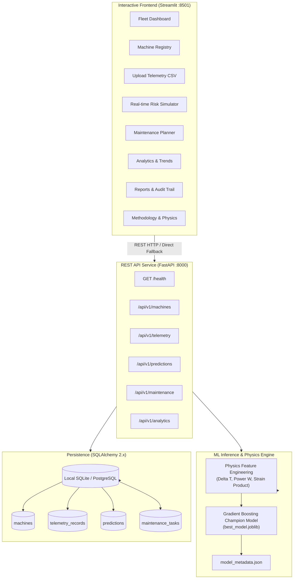
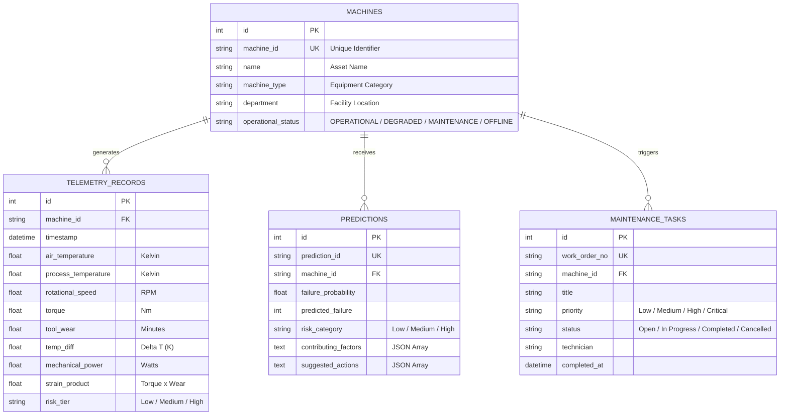

# IntelliMaint-AI — Intelligent Predictive Maintenance Platform

**AI-Powered Industrial Predictive Maintenance Platform**

[](https://www.python.org/)
[](https://fastapi.tiangolo.com/)
[](https://streamlit.io/)
[](https://www.sqlalchemy.org/)
[](https://scikit-learn.org/)
[]()

> **Educational & Engineering Portfolio Project:** An end-to-end industrial software platform integrating physics-grounded telemetry analytics, machine learning failure risk prediction, closed-loop maintenance work orders, and automated PDF inspection reports.

---

## 1. Project Overview & Problem Statement

In industrial manufacturing and electrical drive systems, unexpected machine breakdowns cause catastrophic downtime, expensive scrap rates, and severe spindle damage. Conventional manufacturing relies on:
1. **Reactive Maintenance:** Running equipment until breakdown occurs, leading to high repair costs and unscheduled plant halts.
2. **Preventive Maintenance:** Replacing components on conservative, calendar-based intervals, which discards high-cost cutting inserts and bearings while they still possess substantial operational life.

**IntelliMaint AI** bridges **Electrical and Electronics Engineering (EEE)** telemetry (motor current, cutting torque, rotational speed) with thermodynamics and machine tool wear physics to:
- Predict instantaneous machine failure risk.
- Identify underlying failure mechanisms (Tool Wear, Heat Dissipation, Power Overload, Mechanical Overstrain).
- Explain root-cause degradation factors.
- Dispatch corrective maintenance work orders and compile PDF inspection certificates.

---

## 2. Technology Stack

- **Core Language:** Python 3.13+
- **Interactive Frontend:** Streamlit (with responsive industrial UI design system, KPIs, and sidebar navigation)
- **REST Backend:** FastAPI & Uvicorn (Pydantic v2 schemas, OpenAPI `/docs`, CORS middleware)
- **Data Persistence:** SQLAlchemy 2.x ORM (Zero-configuration SQLite local default; PostgreSQL support via `DATABASE_URL`)
- **Data Science & ML:** Pandas, NumPy, Scikit-learn, Joblib
- **Data Visualizations:** Plotly Interactive Charts
- **Reporting Engine:** ReportLab (Industrial PDF Maintenance Certificates)
- **Client & Testing:** HTTPX, Pytest, Pytest-Asyncio
- **Configuration:** Pydantic Settings, Python-dotenv

---

## 3. Platform Architecture & Data Flow



---

## 4. Database Schema (Entity Relationships)



---

## 5. Machine Learning Pipeline & Actual Evaluation Metrics

### Dataset: UCI AI4I 2020 Predictive Maintenance
- **Records:** 10,000 industrial machine telemetry observations
- **Target Variable:** `Machine failure` (Binary: 0 = Nominal, 1 = Failure)
- **Class Imbalance:** 339 total failures (**3.39% failure incidence**)

### Benchmark Comparison (Stratified 80/20 Test Split)
Evaluated on 2,000 held-out test records containing 68 actual machine breakdowns:

| Algorithm | Precision | Recall | F1-Score | ROC-AUC | PR-AUC (Avg Precision) | Test Accuracy |
| :--- | :---: | :---: | :---: | :---: | :---: | :---: |
| **Gradient Boosting (Champion)** | **0.965** | **0.809** | **0.880** | **0.963** | **0.889** | **99.25%** |
| Random Forest (Balanced) | 0.773 | 0.853 | 0.811 | 0.979 | 0.868 | 98.65% |
| Logistic Regression (Baseline) | 0.181 | 0.882 | 0.301 | 0.939 | 0.419 | 86.05% |

> **Key Engineering Insight:** Accuracy is deceptive under extreme class imbalance. A trivial baseline predicting zero failure yields 96.6% accuracy while missing 100% of machine breakdowns. Gradient Boosting was selected because it delivers an **F1-score of 0.880** with **0.965 Precision** (minimizing costly false alarms) and **0.889 PR-AUC**.

### Top Driving Model Features
1. **Mechanical Strain Product ($\tau \times \text{tool\_wear}$):** 27.2% importance
2. **Mechanical Shaft Power ($P = \omega \cdot \tau$):** 26.3% importance
3. **Spindle Rotational Speed (RPM):** 25.7% importance
4. **Thermal Ratio ($T_{\text{proc}} / T_{\text{air}}$):** 6.3% importance
5. **Tool Wear Duration (min):** 3.7% importance

---

## 6. Project Directory Organization

```text
IntelliMaint-AI/
├── README.md                           # Master Project Documentation & Portfolio Guide
├── requirements.txt                    # Verified Python Dependencies
├── .env.example                        # Environment Variable Template
├── .gitignore                          # Excludes DB, venv, pycache, temporary files
├── pytest.ini                          # Pytest Suite Configuration
├── backend/
│   └── app/
│       ├── main.py                     # FastAPI REST Entrypoint & Middleware
│       ├── config.py                   # Pydantic Settings Configuration
│       ├── database.py                 # SQLAlchemy Engine & Session Lifecycle
│       ├── models/                     # SQLAlchemy Relational Models (Machine, Telemetry, etc.)
│       ├── schemas/                    # Pydantic v2 Validation Schemas
│       ├── routers/                    # Health, Machines, Telemetry, Predictions, Maintenance
│       └── services/                   # Machine, Telemetry, Prediction, Maintenance Services
├── frontend/
│   ├── app.py                          # Streamlit Platform Main Entrypoint
│   ├── pages/                          # Multi-page Application Modules (1 through 8)
│   ├── components/                     # Plotly Chart Builders & Industrial UI Tokens
│   └── utils/
│       ├── api_client.py               # Resilient Client with Direct DB Fallback
│       └── pdf_generator.py            # ReportLab PDF Report Generator
├── ml/
│   ├── data/
│   │   ├── raw/                        # UCI Benchmark / Synthetic Telemetry
│   │   └── samples/                    # Downloadable CSV Template and Demo Datasets
│   ├── models/
│   │   ├── best_model.joblib           # Serialized Gradient Boosting Pipeline
│   │   └── model_metadata.json         # Training Timestamps, Metrics & Feature Importances
│   └── src/
│       ├── dataset.py                  # Telemetry Ingestion & Physics Generator
│       ├── preprocess.py               # Scikit-learn Feature Engineering Pipeline
│       ├── train.py                    # Multi-Model Benchmark & Training Pipeline
│       ├── evaluate.py                 # Industrial Evaluation Metrics (F1, PR-AUC, CM)
│       └── predictor.py                # Real-time Inference & Diagnostic Explainability
├── scripts/
│   ├── init_db.py                      # Database Table Initialization
│   ├── seed_demo_data.py               # Idempotent Demonstration Data Seeder
│   ├── generate_synthetic_data.py      # Telemetry & Sample CSV Generator
│   ├── run_backend.py                  # Uvicorn FastAPI Server Launcher
│   └── run_frontend.py                 # Streamlit Frontend Launcher
├── tests/
│   ├── conftest.py                     # Pytest Fixtures & In-Memory Test Database
│   ├── test_api_endpoints.py           # FastAPI REST Endpoint Integration Tests
│   ├── test_database.py                # Database Persistence, Uniqueness & Cascade Tests
│   ├── test_data_validation.py         # CSV Validation, Range Checks, & Generator Tests
│   ├── test_ml_pipeline.py             # Feature Engineering & Model Inference Tests
│   ├── test_maintenance.py             # Work Order Lifecycle & Transition Rule Tests
│   ├── test_analytics.py               # Fleet KPI & CSV Export Tests
│   └── test_reports.py                 # ReportLab PDF Generation Tests
└── docs/
    ├── architecture.md                 # Deep-dive System Architecture & ER Diagrams
    └── methodology.md                  # Failure Mode Physics & Mathematical Equations
```

---

## 7. Windows PowerShell Quickstart Guide

Run all commands from Windows PowerShell within the project root:

### Step 1: Open Directory & Activate Virtual Environment
```powershell
cd "c:\Users\sandhiya B\OneDrive\Desktop\IntelliMaint-AI"
.\venv\Scripts\Activate.ps1
```

### Step 2: Initialize Database Tables
```powershell
python scripts\init_db.py
```

### Step 3: Seed Demonstration Machines & Telemetry
```powershell
python scripts\seed_demo_data.py
```

### Step 4: Run Machine Learning Training & Evaluation
```powershell
python ml\src\train.py
```

### Step 5: Execute Automated Pytest Suite
```powershell
pytest -v
```

### Step 6: Start the Platform Services

**Terminal 1 — Start FastAPI Backend:**
```powershell
python scripts\run_backend.py
```
*API interactive documentation available at: `http://127.0.0.1:8000/docs`*

**Terminal 2 — Start Streamlit Frontend:**
```powershell
python scripts\run_frontend.py
```
*Interactive dashboard available at: `http://127.0.0.1:8501`*

---

## 8. Automated Test Suite Results

The project includes 30 automated tests executed via `pytest`:

```text
tests/test_analytics.py ..................... PASSED [2/2]
tests/test_api_endpoints.py ................. PASSED [7/7]
tests/test_data_validation.py ............... PASSED [6/6]
tests/test_database.py ...................... PASSED [6/6]
tests/test_maintenance.py ................... PASSED [3/3]
tests/test_ml_pipeline.py ................... PASSED [4/4]
tests/test_reports.py ....................... PASSED [2/2]

======================= 30 passed in 5.74s =======================
```

---

## 9. Third-Year EEE Resume-Ready Project Summary

```markdown
**IntelliMaint AI — Intelligent Predictive Maintenance Platform**
*Full-Stack Python, FastAPI, Streamlit, Scikit-learn, SQLAlchemy, Plotly, ReportLab*
- Developed an end-to-end industrial predictive maintenance software platform forecasting machine tool failure risk across multi-axis CNC machines and hydraulic pumps.
- Engineered domain-specific physics features including heat dissipation delta (Delta T), mechanical shaft cutting power (P = omega * tau), and mechanical strain products.
- Benchmarked Logistic Regression, Random Forest, and Gradient Boosting on imbalanced telemetry (3.39% failure incidence); achieved 0.880 F1-Score, 0.965 Precision, and 0.889 PR-AUC on held-out test data.
- Built a high-performance REST API with FastAPI, Pydantic v2 validation, and OpenAPI documentation; implemented a dual-mode Streamlit control room with interactive Plotly analytics.
- Integrated a full maintenance work-order state machine with transition guards and automated ReportLab PDF inspection report compilation.
- Authored a comprehensive test suite of 30 automated pytest tests covering API endpoints, data validation, ML bounds, and database cascade deletion.
```

---

## 10. Technical Interview Preparation (Q&A)

### Q1: Why did you prioritize F1-score and PR-AUC over Accuracy when evaluating your model?
**Answer:** In predictive maintenance, failure is a rare event (in our benchmark, only 3.39% of records are failures). If a model predicts "No Failure" for every single sample, it would achieve 96.6% accuracy while missing 100% of actual breakdowns. Therefore, Accuracy is fundamentally misleading. We optimized for **F1-score** (harmonic mean of Precision and Recall) and **PR-AUC** to balance detecting genuine degradation events (Recall: 0.809) with avoiding expensive false alarms that disrupt manufacturing schedules (Precision: 0.965).

### Q2: How did you incorporate electrical and mechanical engineering domain knowledge into feature engineering?
**Answer:** Rather than passing raw sensor data blindly to a model, we derived physical parameters:
1. **Mechanical Power ($P = \omega \cdot \tau$):** Calculated from rotational speed ($\text{RPM}$) and spindle torque ($\text{Nm}$) using $P = \frac{2\pi \cdot \text{RPM}}{60} \cdot \tau$ to detect electric motor drive overload or stall.
2. **Thermal Dissipation Delta ($\Delta T = T_{\text{proc}} - T_{\text{air}}$):** Identified heat dissipation degradation when convection between the cutting zone and ambient environment drops below 8.6 K.
3. **Mechanical Strain Product ($\tau \times \text{Tool Wear}$):** Quantified combined physical stress at the workpiece-tool interface to capture overstrain failure.

### Q3: How does the application handle offline backend scenarios?
**Answer:** The frontend client (`IntelliMaintClient`) uses an adaptive resilient communication pattern. It attempts HTTP communication with the FastAPI REST API at `http://127.0.0.1:8000/api/v1`. If the backend server is stopped or unavailable, the client gracefully falls back to direct SQLAlchemy database session operations, allowing standalone demonstration on a student laptop without crashing.

---

## 11. Disclaimer & Boundary Conditions

**Academic & Educational Portfolio Notice:** IntelliMaint AI is developed for academic demonstration and software engineering portfolio purposes. Failure risk scores and diagnostic indicators represent statistical estimations and **must not supersede certified industrial safety systems**, emergency physical stop interlocks, or manufacturer machine operating manuals.
