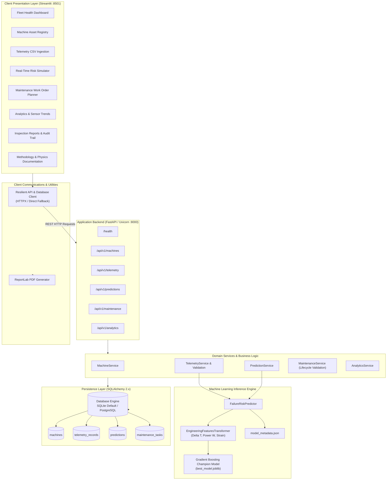
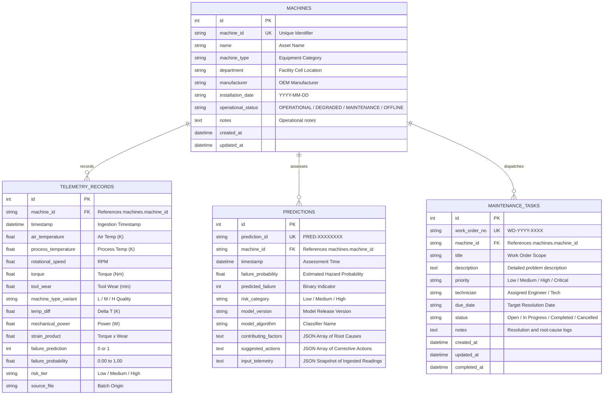

# IntelliMaint AI — System Architecture & Technical Specifications

## 1. System Overview

**IntelliMaint AI** is an intelligent, physics-informed industrial predictive maintenance decision-support platform. It bridges electrical power telemetry, thermodynamic heat convection dynamics, and mechanical degradation physics to forecast industrial machine breakdown risk before unplanned downtime occurs.

The platform is architected with a decoupled full-stack design consisting of:
- **Interactive Multi-Page Presentation Layer:** Built with Streamlit, Plotly, and custom CSS design tokens tailored for industrial control rooms.
- **RESTful Application Programming Interface (API):** Built with FastAPI, Pydantic v2 validation, and OpenAPI 3.1 documentation.
- **Data Persistence Layer:** SQLAlchemy 2.x ORM supporting zero-configuration local SQLite as well as enterprise PostgreSQL via connection string configuration.
- **Machine Learning & Feature Engineering Pipeline:** Scikit-learn Pipeline incorporating mathematical domain features ($\Delta T$, mechanical cutting power $P$, strain product) and serialized Gradient Boosting ensemble models.
- **Reporting & Compliance Engine:** ReportLab document compiler generating formal, multi-section PDF maintenance inspection certificates.

---

## 2. Component Architecture Diagram

---

## 3. Database Schema & Entity Relationships

The relational persistence schema is structured around 4 primary entities enforcing foreign key constraints and cascade rules:

---

## 4. REST API Endpoint Catalog

All routes are documented and testable interactively via Swagger UI at `/docs`.

| Method | Endpoint | Description | Request / Query Body | Response Code |
| :--- | :--- | :--- | :--- | :--- |
| `GET` | `/health` | System health, database connection, and ML status | None | 200 OK |
| `GET` | `/api/v1/machines` | List all registered machines in the fleet | `skip`, `limit` | 200 OK |
| `POST` | `/api/v1/machines` | Register a new machine asset | `MachineCreate` JSON | 201 Created |
| `GET` | `/api/v1/machines/{id}` | Retrieve details of a specific machine | `machine_id` path param | 200 OK / 404 |
| `PATCH`| `/api/v1/machines/{id}` | Update machine status or notes | `MachineUpdate` JSON | 200 OK / 404 |
| `DELETE`| `/api/v1/machines/{id}`| Remove machine and cascade related telemetry | `machine_id` path param | 204 No Content |
| `GET` | `/api/v1/telemetry` | Query historical telemetry readings | `machine_id`, `risk_tier`, `limit` | 200 OK |
| `POST` | `/api/v1/telemetry` | Record single telemetry reading with auto-eval | `TelemetryCreate` JSON | 201 Created |
| `POST` | `/api/v1/telemetry/upload` | Upload and validate batch CSV telemetry | `multipart/form-data` (file) | 200 OK / 422 |
| `GET` | `/api/v1/predictions` | Query historical failure predictions | `machine_id`, `risk_category`, `limit` | 200 OK |
| `POST` | `/api/v1/predictions` | Run real-time ML risk assessment and persist | `PredictionRequest` JSON | 201 Created / 503 |
| `GET` | `/api/v1/predictions/{id}` | Get single prediction assessment by ID | `prediction_id` path param | 200 OK / 404 |
| `GET` | `/api/v1/maintenance` | List maintenance work orders | `machine_id`, `status`, `priority` | 200 OK |
| `POST` | `/api/v1/maintenance` | Create a new maintenance work order | `MaintenanceCreate` JSON | 201 Created |
| `PATCH`| `/api/v1/maintenance/{id}` | Update work order status and completion notes | `MaintenanceUpdate` JSON | 200 OK / 400 |
| `GET` | `/api/v1/analytics/summary` | Real-time database fleet KPIs and overview | None | 200 OK |
